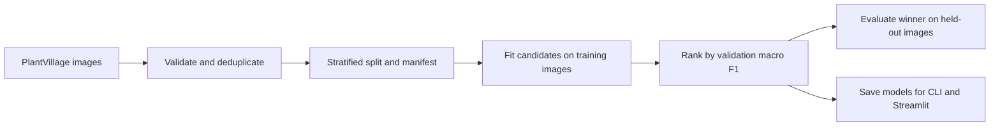
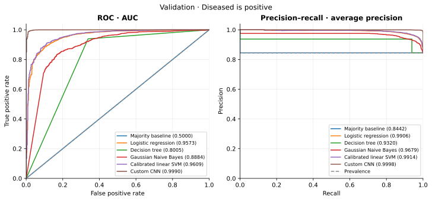

# Predicting Crop Diseases Using Leaf Images

Classify a leaf image as **Healthy** or **Diseased**. A command-line tool and a Streamlit app load saved models for image predictions.

PlantVillage provides labeled, mostly controlled photographs. The research question is how well each candidate recognizes the two labels on held-out images from that collection.

## Quick start

For a fresh checkout, start from the project root with Python 3.11–3.13:

```bash
python3 -m venv .venv
source .venv/bin/activate
python -m pip install -r requirements.txt
python scripts/download_data.py
python scripts/train_models.py --run plantvillage
python scripts/evaluate_models.py --run plantvillage
streamlit run app/streamlit_app.py
```

If the verified CNN artifacts already exist under `models/plantvillage`, install the CNN dependencies with `python -m pip install '.[cnn]'` and start Streamlit directly.

Open [the local app](http://localhost:8501). Choose a saved model and upload one leaf photograph. The first training run creates the model files. Later app launches only load them. The download is approximately 672 MiB and the traditional experiment takes several minutes. If the direct download requires sign-in, download the archive from Kaggle and run `python scripts/download_data.py --archive /path/to/plantdisease.zip`. [Dataset setup and provenance](data/README.md).

To predict from the terminal:

```bash
python scripts/predict_image.py --run-dir models/plantvillage --image /path/to/leaf.jpg
python scripts/predict_image.py --run-dir models/plantvillage --model linear_svm --image /path/to/leaf.jpg
```

Use a new run name for each experiment. Set `CROP_MODEL_RUN=models/<run-name>` to point the app at another run. Set `CROP_DATA_DIR` or pass `--data-dir` to both experiment commands to use a dataset stored elsewhere.

## Pipeline



The scikit-learn models use 1,764 HOG values and 96 RGB histogram values from each 128 × 128 image. The candidates are a majority-class baseline, Logistic Regression, Decision Tree, Gaussian Naive Bayes and calibrated Linear SVM. Macro F1 gives the healthy minority equal weight in model selection. Validation ROC and precision–recall curves, confusion matrices, class-level results and held-out error examples are saved alongside the run. [Methodology](docs/METHODOLOGY.md) · [Architecture](docs/ARCHITECTURE.md).

## Dataset and results

The named Kaggle archive has 20,639 top-level files in 15 tomato, potato and bell pepper folders. The loader validates and deduplicates decoded images before the seeded 70/15/15 split. The academic report describes 38 class folders. [Dataset details](data/README.md).

The Custom CNN led the full PlantVillage validation comparison with **0.9844 macro F1**. On **3,094 held-out images** it achieved **99.13% accuracy**, **0.9832 macro F1** and **0.9988 ROC-AUC**. The majority baseline reached **84.42% validation accuracy** and **0.4578 validation macro F1**. These are image-level results from the rebuilt pipeline. [Full comparison, per-class metrics and historical results](docs/MODEL_EVALUATION.md).



## Neural experiments

```bash
python -m pip install '.[cnn]'
python scripts/train_models.py --run plantvillage-cnn --deep cnn --device auto
python scripts/evaluate_models.py --run plantvillage-cnn
CROP_MODEL_RUN=models/plantvillage-cnn streamlit run app/streamlit_app.py
```

Run the commands above as an alternative experiment before reading a held-out score. Classical candidates and the CNN share the same manifest. `--device auto` selects CUDA, Apple MPS or CPU according to availability. Use `--device cpu` to force CPU execution. The default is up to 12 epochs with early stopping. On Linux without CUDA, install `torch==2.7.1` from the PyTorch CPU wheel index before installing the extra.

The optional transfer-learning experiment downloads approximately 45 MB of ImageNet weights and fine-tunes ResNet18. Install `'.[transfer]'` and use `--deep both` to compare both neural architectures and the classical models on the same validation partition. [torchvision ResNet18 weights](https://docs.pytorch.org/vision/stable/models/generated/torchvision.models.resnet18.html).

## Docker and development

```bash
docker build -t crop-disease-detection .
docker run --rm -p 127.0.0.1:8501:8501 --mount "type=bind,source=$PWD/models/plantvillage,target=/models/plantvillage,readonly" crop-disease-detection
```

Use `--build-arg MODEL_EXTRA=classical` for a smaller classical-only image. Set `MODEL_EXTRA=transfer` to include ResNet18 inference dependencies. Artifacts are mounted at runtime. [Model artifact format and regeneration](models/README.md).

```bash
python -m pip install -r requirements-dev.txt
ruff check .
black --check .
pytest -q
```

CI runs linting, formatting and synthetic tests on Python 3.11. The tests cover image handling, feature parity, training, saved predictions, evaluation and Streamlit integration. [Verification record](docs/IMPLEMENTATION_SUMMARY.md).

## Limitations and next steps

This is an experimental portfolio application. Field lighting, background, camera and plant species can change predictions. Image-level splitting cannot guarantee independence by plant or capture session. A separate group-aware field benchmark would provide stronger evidence of generalization. [Limitations](docs/LIMITATIONS.md).

## Maintainer and academic attribution

**Portfolio maintainer:** Youssef Rafik. The [MIT license](LICENSE) covers the portfolio implementation and its accompanying documentation.

This portfolio rebuild extends a CSC 481 group project from Southern Connecticut State University.

[Project audit](docs/PROJECT_AUDIT.md) · [Publication and licensing](docs/PUBLICATION.md).

## References

- Hughes and Salathé, *An Open Access Repository of Images on Plant Health*. [PlantVillage paper](https://arxiv.org/abs/1511.08060).
- Mohanty, Hughes and Salathé, *Using Deep Learning for Image-Based Plant Disease Detection*. [Frontiers in Plant Science](https://doi.org/10.3389/fpls.2016.01419).
- Dalal and Triggs, *Histograms of Oriented Gradients for Human Detection*. [CVPR](https://doi.org/10.1109/CVPR.2005.177).
- [PlantVillage archive used for this project](https://www.kaggle.com/datasets/emmarex/plantdisease) · [scikit-learn](https://scikit-learn.org/) · [PyTorch](https://pytorch.org/) · [Streamlit](https://streamlit.io/).
