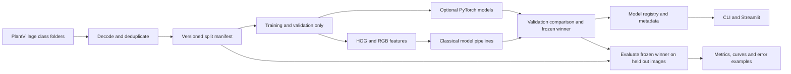

# Architecture

The decoding module owns input limits. Model-specific transforms consume its RGB output. Training defines the candidates and freezes the validation winner in an immutable-by-convention run. The evaluation command verifies the manifest checksum and each held-out image's decoded digest before scoring. A lock file guards against concurrent held-out evaluation. Regenerating a run requires a new name so artifacts and results do not overwrite prior experiments.

Inference needs only the installed package and trusted run artifacts. Prediction accepts paths and uploaded bytes through the same backend. The web app caches loaded models by run directory, model name and manifest contents. Deploy the run directory read-only for inference.
